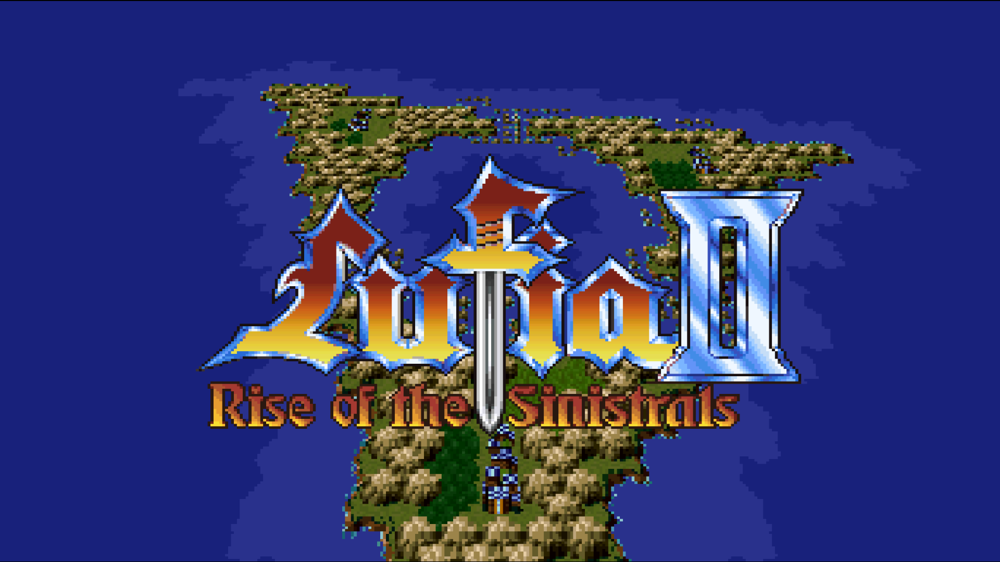
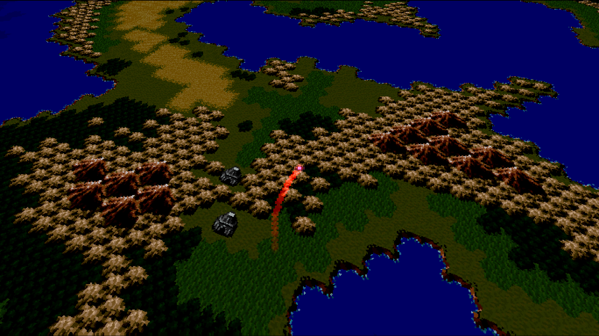
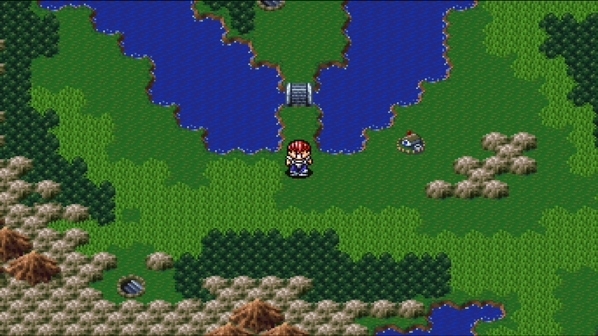
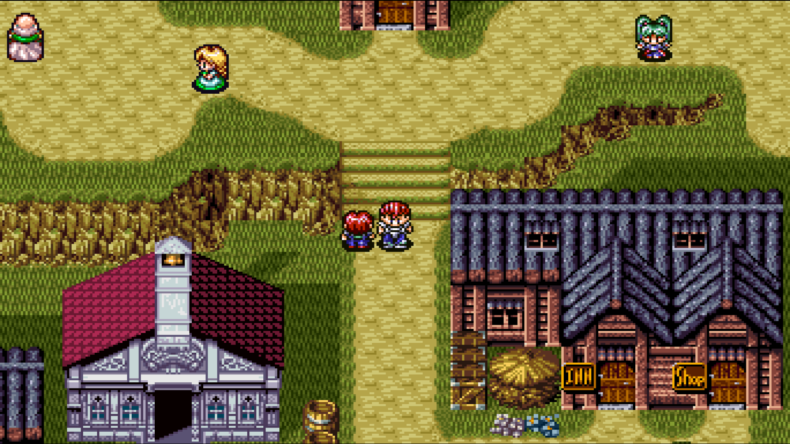
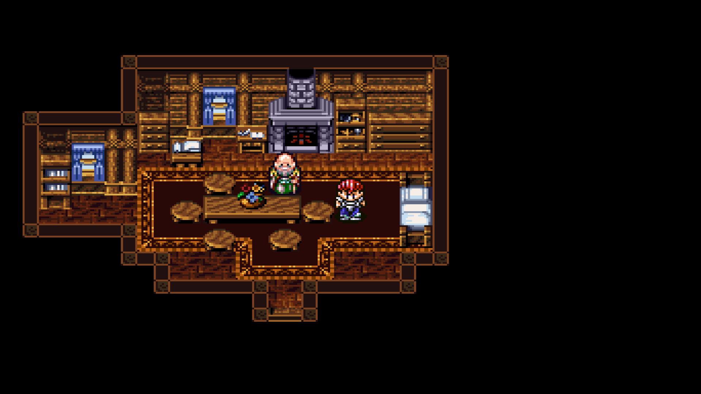
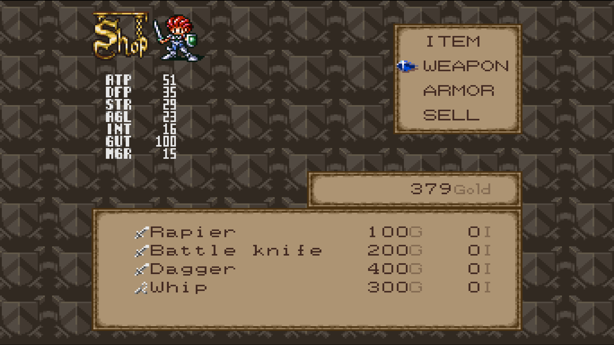
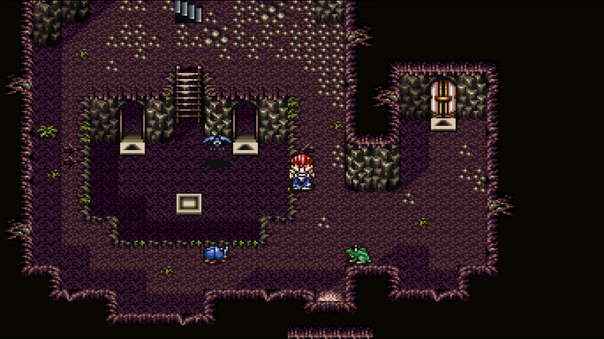
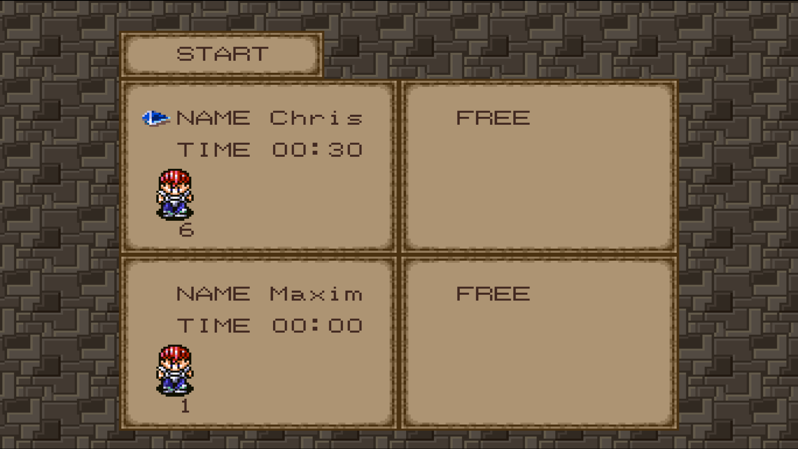

# Lufia II Recompiled

A native recompilation of **Lufia II: Rise of the Sinistrals** using
[`snesrecomp`](https://github.com/mstan/snesrecomp).

The game boots from the original US ROM and supports the intro, title screen,
normal gameplay, battles, audio, input, saves and the desktop launcher. Video
output can use SDL, OpenGL 3.3 or a native Vulkan renderer.

<p align="center">
  
  <br><sub><b>Title screen</b></sub>
</p>

<p align="center">
  
  <br><sub><b>Mode 7 intro flyover</b></sub>
</p>

<table>
  <tr>
    <td width="33%"><br><sub><b>Overworld</b></sub></td>
    <td width="34%"><br><sub><b>Town</b></sub></td>
    <td width="33%"><br><sub><b>Interior</b></sub></td>
  </tr>
  <tr>
    <td><br><sub><b>Shop</b></sub></td>
    <td><br><sub><b>Dungeon</b></sub></td>
    <td><br><sub><b>Save selection</b></sub></td>
  </tr>
</table>

## ROM

The ROM is not included. Use the clean, headerless US release:

```text
Size:   2621440 bytes
SHA1:   A89931C1F29B161B8BE717DFAB4A4ADB54B42B84
SHA256: 7C34ECB16C10F551120ED7B86CFBC947042F479B52EE74BB3C40E92FDD192B3A
```

Place it in the repository root as `lufia2.sfc`.

## Build

### Windows

Requirements:

- Windows 10 or later
- Visual Studio 2022 with Desktop development with C++
- CMake 3.24 or later
- Python 3

Build from the command line:

```powershell
git submodule update --init --recursive
cmake --preset windows-release
cmake --build --preset windows-release
```

The executable is written to:

```text
build\windows\Release\Lufia2Recomp.exe
build\windows\Release\LUFIA2_FUNCTION_SOURCES.txt
```

`LUFIA2_FUNCTION_SOURCES.txt` lists the standalone-decomp replacements used by
that build, decomp candidates that stayed on static recomp fallback, and
consumer-owned HLE overrides.

You can also open `lufia2.sln` and build the Release configuration in Visual
Studio.

### Linux (including the Steam Deck)

Requirements: CMake 3.24 or later, Python 3, GCC or Clang, and the SDL3 build
dependencies. On Debian or Ubuntu:

```bash
sudo apt install build-essential cmake ninja-build pkg-config python3 \
  libgl1-mesa-dev libegl1-mesa-dev libx11-dev libxext-dev libxrandr-dev \
  libxcursor-dev libxfixes-dev libxi-dev libxss-dev libxkbcommon-dev \
  libwayland-dev wayland-protocols libdecor-0-dev libdrm-dev libgbm-dev \
  libasound2-dev libpulse-dev libudev-dev libdbus-1-dev
```

```bash
git submodule update --init --recursive
cmake -S . -B build/linux -G Ninja -DCMAKE_BUILD_TYPE=Release
cmake --build build/linux --parallel
```

The executable is written to `build/linux/Lufia2Recomp`, with `libSDL3.so.0`
staged beside it and an `$ORIGIN` runpath, so the directory can be copied to a
Steam Deck as it is. SteamOS is immutable: build elsewhere and copy it over,
keeping the target glibc no older than the build machine's.

### macOS

Requirements: Xcode command line tools, CMake 3.24 or later, Ninja, Python 3
and a Rust toolchain (`cargo` on `PATH`; the recompiler builds its analyzer
with it). With Homebrew: `brew install cmake ninja rustup && rustup default
stable`.

```bash
git submodule update --init --recursive
cmake -S . -B build/mac -G Ninja -DCMAKE_BUILD_TYPE=Release
cmake --build build/mac --parallel
```

The executable is written to `build/mac/Lufia2Recomp`. Apple Silicon and
OpenGL 3.3 (the system's 4.1 core profile) are what this has been run on.

### Build options

Everything experimental or diagnostic is off by default, so a normal build is
silent and carries no measurement code. The native patches themselves are
production code and are always built; only their instrumentation switches:

| Option | Adds |
|---|---|
| `LUFIA2_ENABLE_RUNTIME_LOG` | map, MSU, widescreen and periodic state tracing |
| `LUFIA2_ENABLE_PATCH_REPORTING` | patch counters and scheduler time every 120 boundaries |
| `LUFIA2_ENABLE_PERF_AUDIT` | the finite Vita performance audit |
| `LUFIA2_ENABLE_DECOMP` | select verified semantic replacements at runtime; OFF keeps the generated/original game-function path |
| `LUFIA2_DECOMP_ROOT` | override the required `Lufia2Decomp` checkout; otherwise use the pinned submodule |
| `LUFIA2_DECOMP_REFERENCE_ONLY` | expose the decomp library without activating native replacements |
| `LUFIA2_ALLOW_UNVERIFIED_ROM` | accept a ROM that is not the clean USA release; see below |

Errors are always reported.

A modified or expanded ROM is refused by default, because the semantic
replacements, the reviewed AOT roots and several fixes are pinned to the clean
USA bytes. `-DLUFIA2_ALLOW_UNVERIFIED_ROM=ON` lifts the gate for local
experiments; combine it with `-DLUFIA2_ENABLE_DECOMP=OFF
-DLUFIA2_ENABLE_REVIEWED_AOT=OFF` so the game runs on the interpreter path
alone. ROM-pinned fixes and assets detect the mismatch and stay inactive, the
launcher still verifies its ROM, so pass the path on the command line.

`Lufia2Decomp` is a required build dependency in every configuration. The host
links its shared resource-format decoder even when semantic replacements are
disabled; `LUFIA2_ENABLE_DECOMP` controls game-function source selection only.

## Run

Start `Lufia2Recomp.exe` to open the launcher, or pass a ROM directly:

```powershell
.\build\windows\Release\Lufia2Recomp.exe "D:\ROMs\lufia2.sfc"
```

On Linux it is `./Lufia2Recomp` in the build directory, same arguments.

Save data is stored in `saves\save.srm` next to the executable.

## Bug fixes

Some bugs from the original game are fixed:

- Buying a spell no longer costs extra gold after a big shopping trip. In the
  original, spending 65,536 gold or more on items could make the next spell
  cost 65,536 gold more than its price tag.
- Equipment names no longer leave leftover letters behind. In the original,
  switching characters with L or R in the equipment or status screen could
  show part of the previous name, such as "Gladiussword".
- The play time clock keeps counting after 99 hours instead of jumping back
  to 00:00, and the menus show three digits for the hours. It stops at
  255:59, the most an original save file can hold.
- Item drops after a battle are always announced. In the original, some
  items you already carried were added without the message saying so.
- HP and MP stop at 999, the most the menus can show. In the original,
  level-ups could push maximum HP past that, and a character with more
  than 1,023 loaded a save with wrong HP and MP.
- Dragon eggs found in the Ancient Cave are no longer lost. In the original,
  an egg could appear in a cave chest and vanished when you left the cave
  or were defeated there, so all eight eggs could never be collected again.
- Being defeated in the Ancient Cave while standing on stairs restarts the
  cave as it should. In the original, the stairs still took you one floor
  deeper with your stats reset, which was almost always fatal.

## Repository

- `recomp/` contains the control-flow information used during recompilation.
- `src/` contains the game host and runtime code.
- `lib/snesrecomp-platform/` is the shared renderer and host submodule.

## Renderer

The launcher offers SDL accelerated, SDL software and OpenGL 3.3. OpenGL can
also use GLSL shader presets. If it cannot start, the game falls back to SDL for
that run.

A build configured with `-DLUFIA2_ENABLE_VULKAN=ON` adds a fourth entry,
`Vulkan`, and accepts `OutputMethod = Vulkan` in `config.ini`. It is a direct
Vulkan renderer: SDL still owns the window, input, audio and the surface, and
everything below the surface is Vulkan. It presents the ordinary framebuffer,
the overlays and HD Mode 7, and it implements Clean-HD as native passes rather
than by loading a `.glslp` preset, so an arbitrary `Shader =` entry stays an
OpenGL-only feature. Vulkan is not the default, and a run that cannot start it
steps down to OpenGL and then to SDL, reporting which renderer it actually
got. Building it needs a Vulkan SDK for the headers, the loader and `glslc`.

`HDMode7` in `config.ini` takes `Off` or a scale from `1x` to `8x`; the
launcher's checkbox turns that configured scale on and off rather than
replacing it. The scale only decides how finely the affine plane is sampled,
never where -- it is separate from `HDMode7Filter`, which stays off so the
pass remains pixel exact. A renderer reports which scales it can allocate, and
a request above that is announced and reduced to the largest one it offers
instead of being dropped or silently substituted.

`PresentRate = Display` in `config.ini` presents on the display's clock
instead of the guest's, so a 144 Hz monitor shows the picture 144 times a
second while the game still advances 60 times. It does not interpolate
motion yet, and it does not touch guest timing, audio or input. Mode 7 scenes
stay at guest cadence because their frame cannot be shown again without
rebuilding it. `PresentRateHz` overrides the detected refresh, which a remote
desktop session reports incorrectly.

FPS, volume, toast and rewind overlays are composited after the game and its
shaders. The default Lufia skin uses the game's logical coordinate space: one
UI texture pixel receives the same aspect, resize, fullscreen, and letterbox
transform as one SNES pixel while remaining a separate overlay.
`SNESRECOMP_UI_SCALE=0.5..3.0` applies an optional user multiplier (rounded to
whole game pixels in this mode). The game-owned skin in
`src/lufia2_overlay_ui.c` supplies a replaceable bitmap font, nine-slice panel
texture, colours and spacing; the shared presenter remains game-neutral.

On desktop, Mode 1 battle backgrounds sample their native picture and authored
side margins in one coordinate space. Heat shimmer, mosaic, colour math and
monochrome palette flashes therefore reach the margins. The battle HUD and
original sprite viewport remain centred; a separate magic tilemap can extend
across the wide screen. Individual sprite spells retain their original geometry.
`LUFIA2_BATTLE_WIDE_EFFECTS=0` restores the previous margin compositor for comparison.

### HD-2D

With the OpenGL renderer, Battle, the world map and towns and dungeons are
presented as small dioramas in the manner of HD-2D games, built entirely from
the original graphics. Each kind of scene has its own switch in `config.ini`, on by
default, and a key that flips it while playing:

| Setting | Key | Scene |
|---|---|---|
| `HD2DBattle` | `F6` | Battle |
| `HD2DWorldMap` | `F7` | the world map on foot |
| `HD2DMaps` | `F8` | towns and dungeons |

`LUFIA2_HD2D=0` or `1` overrides all three for one run. Every other scene, and
every other renderer, shows the picture it always did.

#### Battle

The software PPU still draws the authentic frame. While the Battle scene owns
the screen it also exports BG1, BG2, BG3 and OBJ in isolation through the
runner's host-overlay extraction, and `src/lufia2_hd2d_scene.c` splits them
into three pictures: the background, the *actors* (party sprites, and the
enemies on whichever of OBJ or BG2 the battle currently draws them), and the
*interface* -- whatever the authentic frame shows beyond those two, solved per
pixel against the scanline's colour-math state so that translucent panels stay
translucent. Laid back over the world picture, the interface reproduces the
authentic frame exactly.

Three things are then moved or removed on purpose. While commands are chosen,
each party member is drawn inside its status card; that sprite is a portrait,
so it goes to the interface, and only fighters standing out on the floor are
treated as actors. A battle comes up with the party standing
where those cards are about to be drawn, for the few frames before the game
draws them; until its first panel shows, the party is left out. And the status
bar of the action phase is reduced to its cards: the dark plate and black
rules around them are dissolved so each card stands cut out over the scene.

`src/lufia2_hd2d_gl.c` then stages the world as a room. A reference camera is
placed so that a backdrop plane and a floor plane, textured by projecting the
background through it, look exactly like the SNES picture; each actor is a
billboard standing where its feet meet the floor. From there the scene gets
what a flat frame cannot have: depth of field that leaves the fighters sharp, a
pool of light around the fight, bloom, light shafts and dust, a mirror image
on a polished floor, and a camera that pushes in when the battle
opens and then only breathes. Its lens is shifted and lengthened with every
move so the nearest row of fighters never leaves its place, which keeps the
interface -- drawn last, flat and unfiltered -- aligned with them. The scene
fills the whole window; outside the 4:3 picture the room simply continues.
With `Widescreen = 1` that is also how Battle gets its width: the PPU draws
the native picture, and the margin compositor and the moved HUD cards stand
down while HD-2D is on.

The presenter is not modified. `src/lufia2_hd2d_present.c` wraps the shader
preset hook it already calls with its context current, draws Battle frames
itself and passes all others to the configured preset.

How a background is staged -- where its backdrop meets its floor, the colour
of its haze and shafts, how glossy its floor is -- comes from a small table in
`lufia2_hd2d_gl.c`, keyed on the battle background id.

#### World map

The world map needs no reading as a room: it already is a ground plane, the
Mode 7 plane the game looks straight down on. The camera is tilted back from
that view about the spot the party stands on, so the land runs off into haze
and soft focus, cloud shadows drift over it, and whatever the game draws as a
sprite stands up on the ground. The map is in this view
from its first frame; nothing eases into it.

A tilted camera sees far past the 1024-pixel ring of the world the PPU holds,
so the ground is drawn from the whole 4096-pixel world that
`patches/lufia2_intro_mode7_world.c` already rebuilds for the intro, checked
against the ring every frame; a frame it cannot explain falls back to the ring.
Characters and palette are resolved to colour on the GPU whenever the game
changes them, which is how the sea keeps moving.

Mountains, forests, villages, towers and castles stand up from that ground;
the stairs down to a cave, the one figure that is an opening in the ground
and not a thing on it, is named in the renderer and lies flat.
The game draws them as it draws its sprites, seen from the south, one row of
figures to a row of 16-pixel blocks; lying on a tilted plane they come out
squashed. So each row of blocks stands as a card that leans back from its
southern edge with its own picture on its face, at the slope where the camera
sees the picture as tall as it was drawn. The land or the row behind
disappears below its crest, the party walks behind it, and it throws a shadow
on the ground beside it. Nothing is modelled and no table of tiles is kept:

- what kind of terrain a block is comes from the game's own block table (the
  fifth byte of a block: land, sand, forest, sea, mountain). Sea lies flat,
  and so does land with sea on both sides of it, which is a bridge;
- which pixels of a block are the figure and which the ground around it comes
  from the colours: a colour that land, sand or sea is drawn in to any extent
  is ground;
- a figure taller than one block (a tower, a castle, a great snow peak) is
  recognised by its picture running on across the block's northern edge, and
  its card runs on with it.

That terrain is only known for the rebuilt world, so a frame that falls back
to the ring is flat.

Only the plain walking view is taken over. A frame in which the game turns or
tilts the plane itself, or splits the screen for a text window, keeps its
existing presentation, HD Mode 7 included.

#### Sprites

Sprites are shown as the game draws them, in every scene. Nothing is taken
out of them and no shadow is thrown for them: most carry a shadow of their
own, drawn under their feet.

#### Towns and dungeons

A town or a dungeon keeps the game's own point of view. The picture is the
original one, pixel for pixel, and nothing in it moves against anything else;
what it gains is light. Scenery throws shadows and sits in shade at its foot,
clouds drift over a town, a room or a cave is lit where the party stands and
dark beyond its walls, and the top and bottom of the picture fall softly out
of focus. The view is there from a map's first frame.

For the light the map needs heights, which is the one thing the game does not
store, so every pixel of the map's two tile layers is given one: it shows a
point that many rows above the ground, and as many rows south of where it is
drawn, because these maps draw a step back and a step up alike as one row of
the screen. The heights are read from the game's own layering and collision,
not from a list of tiles. The game draws over its sprites exactly those parts
of the scenery one can walk behind, so each such overhang stands on something
further south:

- a body in the lower layer, down to ground one can walk on: a house under
  its ridge, a bridge's face under its rail. A building is taken for a box two
  storeys high, its walls rising from where they stand and its roof level on
  top;
- or the rest of the same thing on the upper layer: a trunk under a crown,
  the posts of a gate;
- or nothing, and then it belongs to what stands beside it, or stands on its
  own lower edge, or hangs over a way through. A long one, or a body many
  times taller than wide, is a wall seen from above and stays low.

What blocks the way but is drawn under the sprites is low: furniture,
barrels, crates. Forest, recognised as blocked ground the map is tiled with,
rises as a mass. On a map made of rooms everything outside the floor is wall,
as high as the sprites; the pieces the upper layer builds walls from are found
by where the map uses them. Where one can walk comes from the map's walls and
the game's attribute grid, flooded out from the party, and in a room from
everyone in it. Water is learnt by watching which tiles and palette rows the
game animates.

The PPU holds one screen of the map and no more, so beyond the screen the map
is drawn from the processed map the game keeps in bank `$7F`, by the rule the
game itself streams it with, room marks and wrap-around at the map's edges
included. On the screen proper the PPU's own tilemaps are used, which also
hold what the game places on the map at run time. A frame the map does not
explain, or one whose layers scroll apart or carry a raster effect, keeps the
flat picture.

Sprites are drawn from OAM by the scene builder rather than taken from the
PPU's picture, which ends where its screen does: a head above the top row and
feet below the bottom one are the same number in OAM, and the game's own
record of where each actor stands says which it is. Only the actors the game
drew that frame are asked -- its routine draws those inside a window one
screen high -- because an actor a screen further north in the same street
answers to the same row; between one at the top of that window and one at
its bottom, the order the routine draws them in decides. The game also leaves out
of OAM whoever stands beside its 256-pixel screen. While a field is staged,
and under the interpreter, the window its sprite routine tests against is
widened by a hook on `$83:A295`, which is the one place the presentation
writes to guest memory: two words of direct-page scratch the routine has just
stored. Past the screen only actors of the room that is shown are drawn.
Whether a sprite is hidden behind the scenery is the game's own rule, pixel
for pixel: where the map draws a tile over it and nowhere else. Text windows,
the name of the place and whatever else the game writes on its third layer
stay flat on top.

The game names the next map the moment a door is touched and fades the old
one out before it loads anything, so the map in memory is trusted until the
loader is at work, not until the map number changes: the scene stays staged
through the fade.

### Development automation

`LUFIA2_DEV_SCRIPT=<file>` runs the game unattended: scripted pad input, WRAM
pokes, frame captures and a scripted exit, keyed on the guest frame counter.
The window stays hidden and takes no input unless `LUFIA2_DEV_SHOW=1`. The
command list is at the top of `src/lufia2_dev_script.h`; `shot` writes the
composed SNES frame, `hdshot` the HD-2D scene, `ppu` dumps the PPU's registers
and memory, and `layers` records a staged frame for `Lufia2Hd2dPreview`, which replays it through the renderer off
screen at any size:

```bash
cmake --build build/mac --target Lufia2Hd2dPreview
build/mac/Lufia2Hd2dPreview frame.l2hd out.png 1920 1080
```

A recorded world-map frame holds the whole world, so the preview can look at
any part of it: `LUFIA2_HD2D_AT=<x>,<y>` puts that plane pixel at the
picture's top left. For a town or a dungeon, `LUFIA2_HD2D_RELIEF=<out.png>`
writes the heights the light is worked out from as a picture: brighter is
higher, red is drawn over the sprites.

An optional external panel override can be placed beside the executable as
`assets/img/lufia2_menu_panel.tga`. Put `left top right bottom tile`
source-pixel margins in the adjacent `lufia2_menu_panel.9slice`; `tile` makes
patterned edges repeat like the original SNES tilemap instead of stretching.
Missing or invalid TGA files fall through to the authentic panel reconstructed
in memory from the verified ROM. The embedded neutral skin remains the final
fallback if that defensive extraction fails. No reconstructed pixels are
written to disk and no panel image ships with the project.

`scripts/ui_asset_tool.py` crops PNG/BMP/TGA screenshots, applies integer
nearest-neighbour downscaling, losslessly compacts tiled panels, writes the
runtime TGA, and renders a tiled or stretched 9-slice preview. It requires
Pillow (`python -m pip install Pillow`). Example for the native 120x88 panel:

```powershell
python scripts/ui_asset_tool.py panel.png `
  build/windows/Debug/assets/img/lufia2_menu_panel.tga `
  --slice 16 16 16 16 --tile 16x16 --compact --preview 240x88
```

The 48x48 result contains both 16-pixel corner regions and one 16x16 repeat
cell. It recreates the original patterned edges without scaling them.

Rewind preview cells are copied pixel-for-pixel from the rewind core. The
Lufia skin never downsizes them again; the moving filmstrip shows three cells
in a 256-pixel 4:3 frame and four in the standard widescreen frame. Only the
surrounding tiled panel and labels are rebuilt for the available width.

Single-line status badges such as the FPS counter use a compact form of the
same panel: a four-pixel border around a tiled clean centre. This permits a
16-pixel logical height without shrinking the font or stretching the artwork.
While rewind is visible, the FPS badge shares its exact right-hand edge.

See [ISSUES.md](ISSUES.md) for the current limitations.
